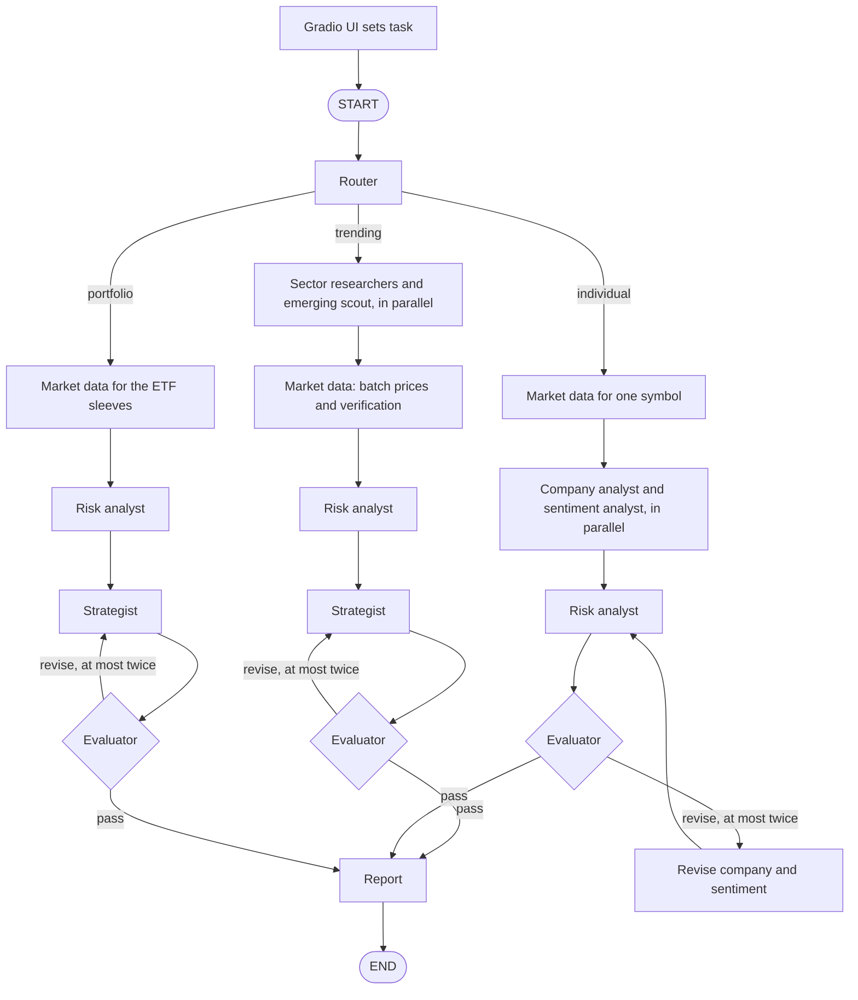

# LangGraph Agentic Architecture

This document describes the multi-agent system in `app_python.py`. The Gradio screens match the original advisor. Behind those screens, one router reads the selected action and starts that tab's graph.

The model is OpenAI `gpt-4o-mini` through `ChatOpenAI`, at a fixed temperature of `0.2` (`0.0` for the evaluator). Live prices come from Yahoo Finance. Reports are written to `investment_advisor.db`.

This is educational research, not financial advice.

## How a request moves

There is one router for the whole app. A button writes the selected action into `task` and calls `run_advisor()`. The router then enters that tab's subgraph. Get Quote does not enter the graph. It calls the market-data check directly and returns the price card.

| Screen control | Value written to `task` | Where the router sends it |
| --- | --- | --- |
| Generate Trending Assets Report | `trending` | Trending subgraph |
| Deep Research | `individual` | Deep-research subgraph |
| Get Quote | `quote` | Market-data function, no graph |
| Generate Portfolio Strategy | `portfolio` | Portfolio subgraph |

`run_advisor()` is wrapped with LangSmith `@traceable(name="investment_advisor")` when a run is traced. Tracing is turned on only if `LANGSMITH_API_KEY` is set.

## Graph flow

`build_graph()` compiles one parent graph, `ADVISOR`. The parent has the router and three subgraphs. List fields inside a subgraph use append reducers, so parallel branches add candidates and log lines instead of overwriting them.



Get Quote never reaches this graph.

## Shared state

The parent state is `AdvisorState`. Each subgraph uses `FlowState`, which adds append behavior for candidates, rejections, logs, and errors. A node returns only the fields it changes.

| Field | Who writes it | What it holds |
| --- | --- | --- |
| `task` | UI | `trending`, `individual`, `quote`, or `portfolio` |
| `research_type`, `sectors` | UI | Trending type and the checked sectors |
| `symbol` | UI | Ticker for a quote or deep research |
| `budget`, `time_horizon`, `risk_tolerance`, `goals` | UI | Portfolio profile |
| `discovered`, `emerging` | Sector researchers and the emerging scout | Candidates, each tagged with its own sector |
| `market_data` | Market data | Quotes that passed verification |
| `rejections`, `rejection_rate` | Market data | Names removed by the data checks, and the share removed |
| `company`, `sentiment` | Company and sentiment analysts | Profile and sourced sentiment |
| `ratings` | Risk analyst | Risk tier, position cap, and Strong Buy, Moderate Buy, Hold, Sell, or Outside your risk profile |
| `weights`, `portfolio` | Strategist | Weights after the code caps, plus the trailing-return mix |
| `report`, `summary_rows`, `stable_rows` | Report writer | Markdown and the two Gradio tables |
| `eval_scores`, `eval_feedback`, `eval_attempts` | Evaluator | Judge scores and the revision count |
| `agent_log`, `errors` | Every node | What ran, and any failure |
| `trace_url` | `run_advisor()` | LangSmith URL, also appended to the report |

## The agents

### Router

The router does not call a model. It records which workflow was requested. `route_start()` then opens the trending, deep-research, or portfolio subgraph.

### Sector researchers and the emerging scout

Used only for trending research. One researcher runs per selected sector, and the emerging scout runs beside them. Crypto uses a single cryptocurrency researcher plus the scout.

Each researcher may call two tools, `search_headlines` and `company_filings`, and then stops. Sector researchers and the emerging scout stop after 2 tool calls. Deep research stops after 4. The emerging scout searches the sectors the user checked and looks for names that are less obvious than the mega-caps. Headlines come from Yahoo Finance. Filings come from the public SEC EDGAR submissions feed. If those tools return nothing, the prompt forbids the word "recent" and the catalyst is marked unverified. A source URL is kept only when it appeared in the tool notes.

The model returns a symbol, name, that asset's own sector, a catalyst, and a thesis. It is not asked for an expected return. Temperature is `0.2`.

### Market data

This step does not use the model. It downloads the whole symbol list with one `yf.download()` call and loads `.info` in a thread pool. A name is kept only when all of these hold:

| Check | Rule |
| --- | --- |
| History | At least 60 trading days |
| Name | The model's name shares a real word with the listed name. A user-typed ticker is accepted as a ticker. |
| Type | Stock, ETF, or crypto, matching the request |
| Freshness | Last price within a few trading days, tighter for crypto |
| Liquidity | 20-day average dollar volume of at least about $1 million |
| Sanity | No zero prices, no 50% daily jump, and a non-zero market cap or fund size |
| Duplicates | One share class, so `GOOG` and `GOOGL` are not both kept |

Rejected names are listed in the report under "Rejected by data checks". The rejection rate is stored for LangSmith.

### Company analyst and sentiment analyst

Used for deep research, and only after the symbol passes the checks. They run at the same time. Both can call the headline and filing tools, with the same cap. Sentiment developments have to carry a source URL when headlines exist. The sentiment score is clamped to `-5` through `5`.

### Risk analyst

The risk analyst does not call a model. From the price history it computes annualised volatility, maximum drawdown, beta against SPY (or BTC for crypto), Sharpe ratio, leverage, and size. Those become a 0–10 score and a tier: low, medium, high, or speculative.

The tier and the user's risk tolerance set a position cap. The Trending tab has its own risk-tolerance choice. A zero cap is rated "Outside your risk profile", which is separate from Sell. A short horizon also tightens the cap on higher-risk sleeves.

The rating uses that risk picture, not a 1-month momentum rule. Strong Buy is reachable without a separate bullish flag: a non-bearish name in a low or medium tier, with a Sharpe ratio of at least 1, a trailing 1-year return of at least 8%, and a drawdown of 30% or less.

### Strategist

The strategist asks the model for weights, then code enforces the limits:

- No weight above that name's cap
- Portfolio cash (`BIL`) stays at or above the minimum for the horizon
- A short horizon cannot put more than 10% in a high-risk or growth sleeve
- When the trending list covers two or more sectors, no sector stays above about 45% if another sector still has room
- Weights are filled up to 100% only where a cap still has room

On the portfolio tab the sleeves are real ETFs: `BND`, `VYM`, `VNQ`, `VTI`, `VUG`, and `BIL`. The number stored as `expected_annual_return` is the trailing 1-year return of that mix, because the existing status line reads that field. The report labels it as trailing history, not a forecast. The five-year figure is only that history compounded, and the report says so.

### Evaluator

The evaluator sits between the strategist and the report. On deep research it reviews the company and sentiment text. It checks the deterministic rules first, then asks the same model, at temperature `0.0`, for suitability, grounding, and compliance scores from 0 to 1. A failing plan goes back to the strategist, or to the research revision on the deep-research path, at most twice. After that the report is written anyway, with the evaluator's note included.

Those scores, and the market-data rejection rate, are sent to LangSmith as feedback when a trace exists.

### Report writer

The report is markdown. Buy-rated trending rows include Market Cap and match the first table. Hold and Sell rows omit Market Cap and match the second table. Portfolio rows keep the columns Asset Class, Allocation, Amount, and Risk Level. The trace link is appended to the report body when LangSmith has a URL.

Quotes are not saved. Trending, deep-research, and portfolio reports are still saved to the existing SQLite history tables.

## LangSmith

Tracing starts only when `LANGSMITH_API_KEY` is present:

- `LANGSMITH_TRACING=true`
- `LANGCHAIN_TRACING_V2=true`
- Project name from `LANGSMITH_PROJECT`, otherwise `ai-investment-advisor`

Without a key, those flags stay false and runs are not uploaded. With a key, `run_advisor()` is one chain. The graph config adds a run name such as `advisor-trending`, plus tags for the task. After the run, evaluator scores are logged with `create_feedback`.

## What happens when a step fails

A researcher that fails adds an error and an empty candidate list. The other researchers still join. A symbol that fails verification is listed and skipped. A failed model call on the strategist falls back to the capped weights. A failed judge does not by itself send the plan back. The report is still written from whatever passed.

## Run it

```bash
python app_python.py
```

Required environment variables:

- `OPENAI_API_KEY` for the model agents
- `LANGSMITH_API_KEY` to upload traces and feedback
- `SENDER_EMAIL` and `SENDER_PASSWORD` only for the email buttons

`LANGSMITH_PROJECT` is optional.

The same module is what the Hugging Face Space `AIInvestmentAdvisorProLangGraph` runs, uploaded there as `app.py`. On that Space, ZeroGPU requires one `@spaces.GPU` function at startup. That function does no investment work. Locally, if the `spaces` package is absent, the import is skipped.
