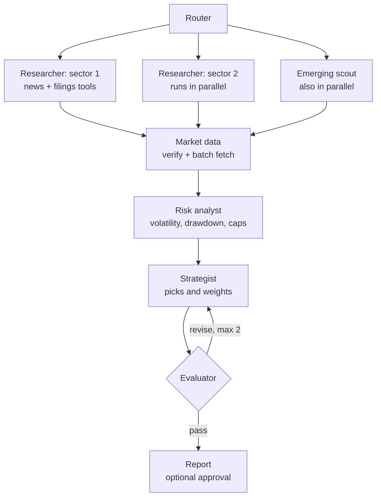

# AI Investment Advisor (LangGraph): architecture review and improvement plan

Review of `app.py` from `rsoundarya/AIInvestmentAdvisorProLangGraph`.

## Summary

The app is a **router-dispatched, multi-path workflow on a shared state**, built with LangGraph and traced with LangSmith. It is a clear step up from the original single-file version: it has role-specific nodes, Pydantic structured outputs and per-node tracing.

It is not yet an autonomous multi-agent system, and that is fine. A fixed workflow is the right shape for this problem. The weaknesses are inside the nodes:

- **No grounding.** The LLM nodes reason from training memory, with no news, filings or search.
- **The decisions that matter are fixed rules.** Ratings come from 1-month momentum, and the allocation comes from a lookup table.
- **Nothing checks the output** before it reaches the user.

The recommendation is to keep the router and the existing UI, and upgrade what happens inside each path.

## How the current architecture works

### Paths through the graph

Each UI button sets `task`, and two conditional edges (`route_start`, `after_market_data`) choose the path.

| Button | `task` | Path | LLM calls |
|---|---|---|---|
| Generate Trending Assets Report | `trending` | router → discovery → emerging → market_data → risk_agent → report_writer | 2 |
| Deep Research | `individual` | router → market_data → company_analyst → sentiment_analyst → risk_agent → report_writer | 2 |
| Get Quote | `quote` | router → market_data → report_writer | 0 |
| Generate Portfolio Strategy | `portfolio` | router → portfolio_strategist → report_writer | 1 |

`market_data`, `risk_agent` and `report_writer` are shared nodes that branch internally on `state["task"]`.

### Node roles

| Node | Type | What it actually does |
|---|---|---|
| Router | Code | Logs a message; the routing itself happens in `route_start` |
| Discovery Agent | LLM (temp 0.6) | Proposes 6 tickers from memory, with a randomly chosen research angle |
| Emerging Agent | LLM (temp 0.7) | Proposes 4 more, excluding Discovery's picks |
| Market Data Agent | Code | Sequential yfinance calls; drops tickers with an empty 1-month history |
| Company Analyst | LLM (temp 0.2) | Company profile from memory, given only price and sector |
| Sentiment Analyst | LLM (temp 0.3) | Sentiment from memory, given only 1M and 1Y returns |
| Risk Agent | Code | `rate_performance()`, based on 1-month return and sentiment |
| Portfolio Strategist | Table + LLM | Allocation from `ALLOCATIONS`; the LLM only writes the narrative |
| Report Writer | Code | One Markdown template per task |

### Where it sits on the agentic spectrum

| Property | Status |
|---|---|
| Role decomposition into named nodes | Yes |
| Structured LLM outputs (Pydantic) | Yes |
| Orchestration framework (LangGraph) | Yes |
| Per-node tracing (LangSmith) | Yes |
| LLM decides control flow | No, routing is by the `task` string |
| Agents call tools themselves | No |
| Loops or self-correction | No, the graph is acyclic |
| Parallel execution | No |
| Memory across runs | No, apart from SQLite report storage |

In standard terms: routing plus prompt chaining.

## Bugs to fix first

1. **Strong Buy can never appear on the Trending tab.** `risk_agent_node` calls `rate_performance(1m_return)` without a sentiment argument, so sentiment defaults to `NEUTRAL`. Strong Buy requires `BULLISH`.
2. **The Hold/Sell table has an empty Market Cap column.** `_quote_row(..., include_market_cap=False)` omits the field for Hold/Sell rows, but `stable_table` doesn't declare that column, so the dataframe schemas don't line up.
3. **The minimum budget is inconsistent.** The input says `Minimum: $200`, but `portfolio_wrapper` rejects anything under $1,000.
4. **Results aren't reproducible.** The random research angle in `discovery_node`, plus temperatures of 0.6–0.7, mean two identical requests give different reports. That makes comparisons in LangSmith meaningless.
5. **Every asset gets the same sector label.** Discovery and Emerging assign `", ".join(sectors)` to every asset instead of that asset's own sector.
6. **Tracing is forced on.** `LANGSMITH_TRACING` is set to `"true"` unconditionally. Without an API key this produces upload warnings instead of switching tracing off.
7. **`expected_return_pct` is requested but never used.** It asks the LLM for an invented number that appears nowhere. Remove it from `DiscoveredAsset`.
8. **Two errors are shown as successes.** A missing API key shows the green "Success: API Key Required" banner, and "No X discovered" also uses `success-msg`.

## Improvements, in order of impact

### 1. Ground the LLM agents with tools

This is the one place where letting the agent decide pays off.

- Turn each researcher into a small tool-using agent with a hard cap on tool calls (around 3–5).
- Useful tools: a news search (for example Tavily), the yfinance `Ticker.news` feed, and SEC EDGAR filings.
- Give the Sentiment Analyst real recent headlines and require it to cite source URLs.
- If no news tool is configured, tell the model so explicitly, and forbid it from describing anything as "recent".

### 2. Verify market data properly

Today the only check is `if hist_1m.empty: continue`. Replace it with these checks, all in plain Python:

| Check | Rule | Why |
|---|---|---|
| Exists | At least ~60 trading days of history | A few days of data often means a delisted or lookalike ticker |
| Name matches | LLM's name roughly matches yfinance `longName` | Models often pair a real ticker with the wrong company |
| Right asset type | `quoteType` is `EQUITY`, `ETF` or `CRYPTOCURRENCY` as expected | Stops ETFs appearing in a stocks report |
| Current | Last price within a few trading days (less slack for crypto) | Stale prices suggest a halt or delisting |
| Liquid | 20-day average dollar volume ≥ ~$1M | Thin trading means unreliable prices and pump-prone names |
| Sane | No zero prices, unexplained 50%+ daily moves, or zero market cap | Catches bad data before it's rated |
| No duplicates | Merge share classes such as `GOOG` and `GOOGL` | Matters once researchers run in parallel |

Record every rejection with its reason, show a "Rejected by data checks" section in the report, and track the rejection rate in LangSmith.

At the same time, replace the per-ticker history calls with one batched `yf.download()`, and fetch `.info` in a thread pool.

### 3. Run independent work in parallel

- Use LangGraph's `Send` to run one researcher per selected sector at the same time.
- Run the Emerging scout alongside them and remove duplicates afterwards, instead of making it wait for Discovery.
- On Deep Research, run the Company and Sentiment analysts together.
- Add `operator.add` reducers on list fields such as logs, errors and candidates, so parallel branches don't overwrite each other.

### 4. Make the Risk agent measure risk

- Compute annualised volatility, maximum 1-year drawdown, beta against a benchmark (SPY, or BTC for crypto), Sharpe ratio, leverage (D/E) and size.
- Combine these into a 0–10 risk score and a tier: low, medium, high or speculative.
- Map each tier to a per-asset position cap based on the user's risk tolerance. Exclude tiers the profile doesn't allow; for example, a Conservative profile never sees speculative names.
- Keep this deterministic. It's precise, testable and can't hallucinate.

### 5. Let the Strategist decide, inside limits enforced by code

- Portfolio tab: map asset classes to real instruments (for example a broad bond ETF, a dividend ETF, a REIT ETF), price and risk-check them, and let the LLM choose weights based on goals, horizon and market conditions.
- Trending tab: base ratings on risk-adjusted metrics and the user's profile, not momentum percentiles.
- After the LLM responds, code trims any weight above its cap, enforces a minimum cash level, and makes the weights add up to 100%.
- Replace `EXPECTED_RETURNS` projections with clearly labelled historical ranges, or drop them.

### 6. Add an evaluator loop

Add an evaluator node between the strategy and the report. If the plan fails, it goes back to the Strategist with specific feedback, at most two times.

- **Deterministic checks:** every holding was verified by market data, weights are within caps, weights plus cash equal 100%, minimum number of holdings, sector concentration below about 45%, and a short-horizon profile isn't heavy in high-risk names.
- **LLM judge** (ideally a stronger model than the generator): scores for suitability, grounding (claims supported by the supplied data) and compliance (no guarantees or hype).

### 7. Split the graph into one subgraph per tab

Give each tab its own small subgraph with its own typed state, behind the same router. This removes the `if task == ...` branches from shared nodes, and a change to one tab can't break another.

### 8. Use LangGraph for persistence, progress and approval

- **Checkpointer.** `SqliteSaver` makes runs resumable and can replace the hand-built SQLite history.
- **Streaming.** `graph.stream(stream_mode="updates")` lets the UI show live progress from each agent instead of one long spinner.
- **Approval.** `interrupt()` before the final report gives an optional human sign-off.
- **Quote button.** `Get Quote` shouldn't run the full graph; call the market data tool directly.

### 9. Make LangSmith measure quality

- Log the evaluator's scores as LangSmith feedback on each trace, so quality can be charted and alerted on.
- Build a dataset of investor profiles and run `client.evaluate(...)` experiments before changing prompts or models.
- Show the trace link in the UI; `trace_url` is already computed.
- Enable tracing only when `LANGSMITH_API_KEY` is set.
- Remove the random research angle and use low, fixed temperatures.

## Proposed architecture (trending path)

The Deep Research path follows the same pattern: verify market data, run the Company and Sentiment analysts in parallel, then the Risk analyst, the Evaluator and the Report.

## What not to add

- **An LLM supervisor that routes between agents.** The router already knows the path for free; an LLM would add cost, latency and failure modes.
- **Free-form agent group chats.** Expensive, unpredictable and hard to debug.
- **Agents with unlimited tool loops.** Always cap tool calls.

One optional pattern is worth considering for Deep Research: a **bull analyst and a bear analyst who each argue their case, with a judge weighing them.** It pushes back on one-sided LLM optimism, at the cost of about two extra LLM calls per stock.

## Suggested order of work

1. **Quick fixes:** bugs 1–8, fixed temperatures, conditional tracing.
2. **Data quality:** market data verification, batched fetching, a real risk agent.
3. **Grounding:** news and filings tools for the researchers and the Sentiment Analyst.
4. **Decisions:** a constrained Strategist and the evaluator loop.
5. **Structure:** subgraphs per tab, `Send` parallelism, reducers.
6. **Operations:** checkpointer, streaming progress in the UI, LangSmith feedback and evaluation datasets.

Steps 1–2 alone remove most of the hallucinated or misleading output. Steps 3–4 are where the system starts making grounded, checked recommendations.

Throughout all of this, keep the existing UI, CSS, email and history features unchanged, and change only the code above the `# UI` section.
